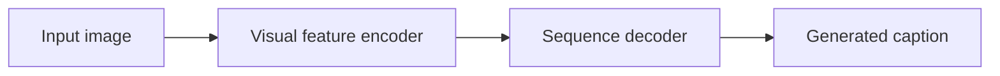

# Image Caption Generation

A concept repository exploring how computer vision and language generation can turn an image into a short textual description.

## Motivation

An image is not directly searchable or readable as a sentence. Captioning models connect visual information with language, making the task a useful learning exercise at the intersection of computer vision and natural-language processing.

## Current status

The public repository currently contains only this README. It does **not** contain application source, a training notebook, datasets, model weights, or a dependency manifest.

The original project description proposed Python, Flask, and an LSTM-based caption generator. Those are design intentions, not implemented capabilities in this repository.

## Conceptual architecture

This diagram describes the concept only. A CNN can provide visual features, while an LSTM can generate a sequence of caption tokens; the actual model selection and implementation are not present here.

## Using this repository

Read the project overview on GitHub. There is no installation or run command for the current contents, and no model performance or deployment result is claimed.

## Contribution context

Any future implementation should document its dataset, preprocessing, model artifacts, evaluation method, and reproducible environment alongside the code. The present repository is an introduction to the idea.
